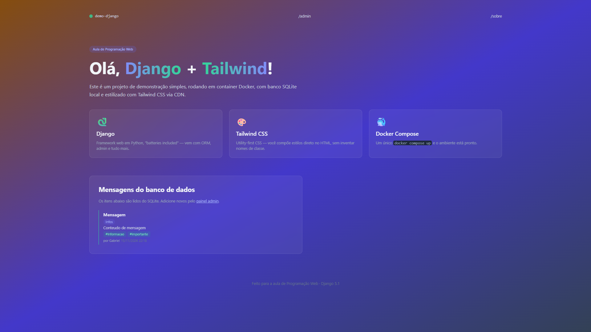
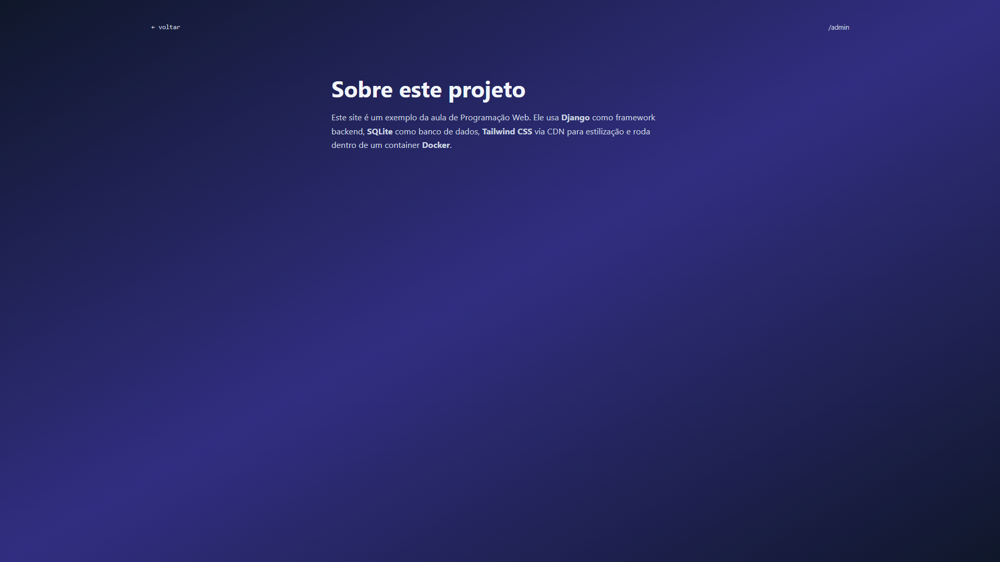
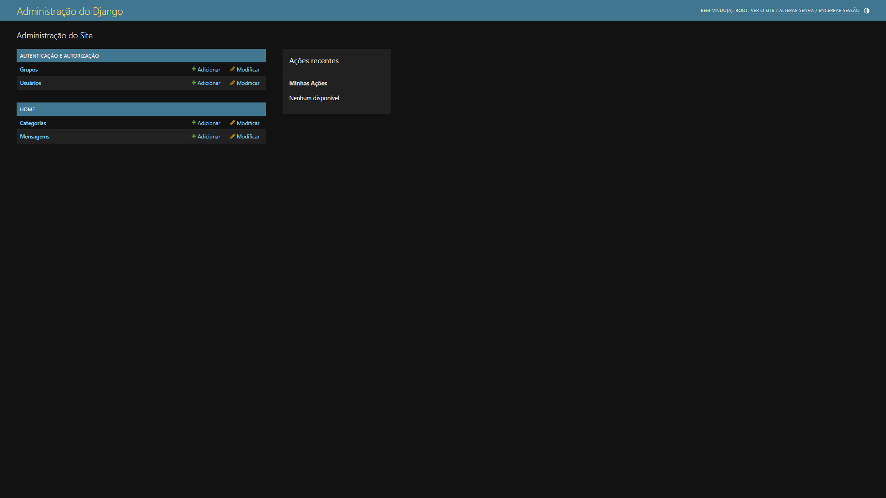

# Demo Django + Tailwind

- **Nome:** Gabriel Barony Menezes
- **Curso:** Bacharelado em Ciência da Computação — Universidade Federal de Ouro Preto (UFOP)
- **Disciplina:** Programação Web

Aplicação web de demonstração desenvolvida para a disciplina de **Programação Web**, utilizando **Django 5.1.3**, **Tailwind CSS** (via CDN), **SQLite** e **Docker Compose**. O sistema permite o cadastro e gerenciamento de categorias, tags e mensagens pelo painel administrativo e sua exibição dinâmica na página inicial.

## Capturas de Tela


### Página Inicial (`/`)


### Página Sobre (`/sobre/`)


### Painel Administrativo (`/admin/`)


## Funcionalidades e Rotas

- **`/` (Página Inicial)**: Lista todas as mensagens cadastradas no banco de dados SQLite ordenadas da mais recente para a mais antiga, exibindo título, categoria, tags (`#tag`), conteúdo, autor e data/hora de criação (`America/Sao_Paulo`).
- **`/sobre/` (Sobre)**: Página institucional com informações sobre a arquitetura e tecnologias utilizadas no projeto.
- **`/admin/` (Painel Administrativo)**: Interface nativa do Django (em `pt-br`) configurada para gerenciamento (`CRUD`), busca e filtragem de **Categorias**, **Tags** e **Mensagens** (incluindo seletor horizontal para vinculação de múltiplas tags).

## Modelo de Dados (`home`)

- **`Categoria`**:
  - `nome`: Texto único (até 50 caracteres), ordenado alfabeticamente.
- **`Tag`**:
  - `nome`: Slug único (até 30 caracteres), ordenado alfabeticamente.
- **`Mensagem`**:
  - `titulo`: Texto (até 120 caracteres).
  - `conteudo`: Texto longo.
  - `autor`: Texto (até 80 caracteres, padrão `"Anônimo"`).
  - `categoria`: Chave estrangeira opcional (`SET_NULL`) relacionada a `Categoria`.
  - `tags`: Relacionamento muitos-para-muitos (`ManyToManyField`, opcional) relacionado a `Tag`.
  - `criada_em`: Data e hora preenchidas automaticamente na criação.

## Pré-requisitos

- **Opção 1 (Recomendada):** Docker e Docker Compose;

## Como Executar

### Opção 1: Com Docker Compose

1. Clone o repositório e acesse a pasta do projeto:
   ```bash
   git clone <url-do-repositorio>
   cd demo-django
   ```

2. Suba o container da aplicação:
   ```bash
   docker compose up --build
   ```

3. Em outro terminal, aplique as migrações e crie um superusuário para acessar o `/admin`:
   ```bash
   docker compose exec web python manage.py migrate
   docker compose exec web python manage.py createsuperuser
   ```
   *(Substitua `web` pelo nome do serviço definido no seu `docker-compose.yml`, caso seja diferente).*


Após iniciar, acesse:
- **Aplicação:** `(http://127.0.0.1:8000/)`
- **Admin:** `(http://127.0.0.1:8000/admin/)`

## Comandos Úteis

```bash
python manage.py check           # Verifica problemas de configuração no projeto
python manage.py makemigrations  # Cria novas migrações após alterações em models.py
python manage.py migrate         # Aplica as migrações no banco de dados
python manage.py test            # Executa a suíte de testes automatizados
```
